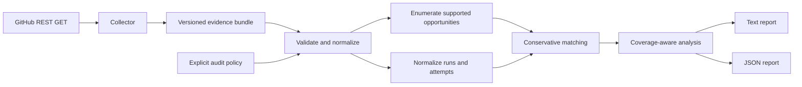

# Architecture — proposed

No modules described here are implemented. This design prioritizes an auditable small program over broad automatic inference. [PRODUCT_SPEC.md](PRODUCT_SPEC.md) defines user-visible behavior; [RESEARCH.md](RESEARCH.md) identifies supporting facts and their limits.

## Stack decision

Recommend **TypeScript on Node.js 24 LTS**, ESM, npm with a committed lockfile, built-in `fetch`, `node:crypto`, and `node:test`. Use a maintained YAML 1.2 parser (`yaml`) and evaluate `cron-parser` behind a narrow adapter. Exact dependency versions are selected and pinned only at implementation time after checking licenses, maintenance, and semantic compatibility. Do not assume the parser's default grammar or DST behavior matches GitHub.

Rationale: typed evidence/result unions make uncertainty explicit; Node suits developer CLI/Actions use and avoids a web stack. Built-in HTTP and test tooling limit dependencies. Runtime validation is still required at every external boundary; TypeScript types alone do not validate API JSON. Start with small handwritten validators; adopt a schema library only if it simplifies the stable bundle contract.

Python is a credible alternative, especially for contributing to Cronkeeper, but requires care with YAML's `on` key and dependency distribution. Go simplifies single-binary delivery and may suit a Schedule Lens contribution, but distribution alone is not worth a rewrite. The maintainer's existing language fluency should override the recommendation before implementation; it is not a user-approved choice yet.

## Boundaries

Network access ends at the collector. The analysis library takes data and an explicit observation instant; it never reads the clock, credentials, filesystem, or network. The CLI orchestrates validation and serialization. There is one package, no daemon, database, plugin framework or microservices.

| Proposed module | Responsibility | Must not do |
| --- | --- | --- |
| `domain` | Versioned evidence, policy and result types; reasons and invariants | HTTP, filesystem, presentation decisions |
| `github` | Allowed GET endpoints, pagination, partitioning, retry/budget behavior | Interpret zero results as missed events |
| `bundle` | Validate manifest, field projection, hashes, bounded filesystem reads/writes | Save credentials or silently repair corrupt evidence |
| `schedule` | Safe YAML extraction, subset validation, UTC occurrence enumeration | Evaluate workflows, execute expressions, assume unsupported zones |
| `normalize` | Deduplicate IDs, select original attempt metadata, validate timestamps | Count reruns as fresh schedule triggers |
| `match` | Build candidates and conservative one-to-one/ambiguous groups | Pick nearest slot just to improve reported coverage |
| `analyze` | Combine coverage, policy, observations, classifications and metrics | Infer scheduler root cause or internal queue time |
| `report` | Deterministic text/JSON formatting and escaping | Change classifications or fetch additional evidence |
| `cli` | Arguments, token lookup, I/O, exit codes | Hide partial collection or add background monitoring |

## Proposed evidence model

The bundle is a directory with a JSON manifest, projected run/attempt records, workflow metadata, and the pinned workflow YAML. It is not a dump of the entire API response. The manifest records which fields were retained so “raw evidence” is never an inaccurate promise.

Record:

- Bundle schema version, collector version, selected API version, repository ID/name, workflow ID/path, default branch and pinned ref observed at collection.
- Collection start/end, fixed `observed_until`, requested interval, attribution horizon, exact query partitions, page counts, response status, selected request IDs, ETags if used, and completeness diagnostics.
- Workflow content/blob and commit identity, content digest, current state and observation timestamp. Distinguish a file snapshot from historical eligibility evidence.
- Run ID, workflow ID, event, `created_at`, `run_started_at`, `run_attempt`, status, conclusion, head SHA, head branch, HTML URL, and record fetch time. Whitelist fields; omit author emails, commit messages, logs, tokens and unrelated source.
- Original-attempt data where fetched and its retrieval status. Latest conclusion and original conclusion must be different nullable fields.
- Per-file SHA-256 digests; hash a canonical manifest core to derive bundle identity without a circular hash. Hashes detect change, not authenticity or a GitHub signature.

An audit policy is separate from collection evidence, so two interpretations can be compared against the same bundle. A report records its policy digest and analysis version. Preserve the bundle plus policy plus tool/dependency versions for replay; a fresh API collection is a new observation, not a promise to regenerate identical inputs.

## Collection protocol

Suggested endpoint set; paths are relative to `https://api.github.com`. All requests use GET. Pin `X-GitHub-Api-Version` (current reviewed examples use `2026-03-10`) and `Accept: application/vnd.github+json`; verify that version against the live contract when implementing.

| Endpoint | Purpose | Scope |
| --- | --- | --- |
| `/repos/{owner}/{repo}` | Identity and observed default branch | Metadata |
| `/repos/{owner}/{repo}/actions/workflows/{id-or-file}` | Resolve current workflow ID/path/state | Actions: read |
| `/repos/{owner}/{repo}/commits/{ref}` | Resolve a branch to an immutable commit | Contents: read |
| `/repos/{owner}/{repo}/contents/{path}?ref={sha}` | Pin the workflow definition | Contents: read |
| `/repos/{owner}/{repo}/actions/workflows/{id}/runs` | List scheduled records in bounded creation windows | Actions: read |
| `/repos/{owner}/{repo}/actions/runs/{id}/attempts/1` | Recover original-attempt details when needed | Actions: read |

Path-scoped commit listing can later help review changes; it is not required by the first collector. No job-log/artifact APIs are needed.

Algorithm recommendations:

1. Freeze observation time before requests, resolve repository/workflow identities, resolve and fetch pinned content. Record start/end metadata observations; if identity/path/definition changes during collection, surface a conflict rather than combining snapshots silently.
2. Use `event=schedule`, `per_page=100`, and bounded `created` ranges. Do not filter conclusion or present branch: cancellations are relevant, and the default branch may have changed historically.
3. Treat the documented filtered-search cap conservatively: split any time partition reporting **at least** 1,000 results. Split again until below the cap or time resolution/request budget prevents it. Deduplicate overlapping inclusive-second API boundaries by run ID; apply half-open filtering locally. At an indivisible saturated timestamp, report truncation.
4. Follow validated same-origin pagination links within each partition. Detect repeated pages, inconsistent counts, duplicate records and changing records. A terminal page alone is not proof of historical completeness.
5. Recheck the bounded partitions once after traversal for count/ID changes; on instability either retry within budget or mark the affected range incomplete. Preserve successive projected observations with fetch timestamps. For matching, contradictory supposedly invariant fields (identity/event/creation time) make affected evidence unknown. For mutable status/conclusion/attempt fields, select the latest fetched observation and retain prior observations as provenance. Even a stable recheck is not an atomic snapshot or proof against invisible same-count deletion/replacement. Label coverage `api_traversal_complete` only in this limited sense.
6. Normalize reruns by `(repository_id, run_id)`. Fetch attempt 1 when latest-attempt timestamps cannot safely support original-start analysis. If unavailable, retain existence evidence from the run record but leave original-start metrics unknown.
7. On 401/403/404, distinguish denied/unknown access from empty history. On 429 or secondary-limit responses, honor `Retry-After`/reset and bounded retries. Backoff on transient failures; do not retry permanent errors indefinitely. If the request/time budget is exhausted, persist a clearly partial bundle when possible and return code 3.

**Coverage has independent dimensions:** API traversal; historical record availability; schedule validity; workflow/repository eligibility; boundary context; supported semantics. Each has `observed`, `operator_asserted`, `unknown`, or an applicable error state with interval/reason. A single `complete: true` flag is inadequate. Ordinary run-list pagination cannot establish that no runs were deleted.

`observed_until` limits which creation timestamps are eligible for this analysis. It does not reconstruct the status of every run at that instant: a run may complete or be rerun while collection is in progress. Conclusions and original-start observations must display their fetch provenance, and a start later than the creation cutoff remains a later observed fact, never an assertion that the run had started by the cutoff. Replay freezes these captured observations, not GitHub itself.

## Schedule history and eligibility

For the initial MVP, the operator identifies one stable interval and supplies explicit bounded assertions. Without them, show recorded runs and unknown opportunities. Do not silently infer the whole past from current YAML. The first collector supports only historical intervals whose reviewed definition matches its pinned current file. A prior differing definition requires an already-captured matching bundle; arbitrary historical-ref selection and multi-epoch reconstruction are future work. Do not bridge changes by assumption.

Future reconstruction may compare default-branch snapshots or path history. Commit author/committer timestamps do not prove when a commit reached the default branch or when GitHub registered a schedule. Merges, rebases, force-pushes, renames, deletion/recreation, and default-branch switches need explicit uncertainty intervals. `head_sha` on a run proves the run's code identity, not the full schedule configuration at the intended opportunity.

Current workflow `state` is only a timestamped observation. `updated_at` is not a disablement transition ledger. Do not subtract exactly 60 days from a last commit and call the resulting window disabled: the documented rule refers to repository activity, and the collector lacks the complete eligibility history. Repository Actions restrictions, actor deprovisioning, inactivity, fork behavior and invalid definitions can all complicate eligibility. Record known disablement as an operator exclusion; leave uncertain periods unknown.

Workflow-level concurrency and job conditions affect whether work executes. If a scheduled run record exists but it is cancelled/skipped, record that conclusion separately. Absence does not identify whether concurrency, account restrictions, retention, validation or the scheduler caused it. Manual remediation remains a different event type.

## Matching contract

Let an opportunity be `s`, a run's recorded creation time be `c`, late tolerance be `L`, and maximum attribution horizon be `H`. Initial defaults are `L=30m`, `H=24h`; both are reviewable product assumptions, not measurements or GitHub guarantees.

Candidate edge: same repository/workflow, `event=schedule`, eligible compatible definition, and **`0 <= c-s <= H`**. No early tolerance initially; a negative lag is evidence of a model/timestamp problem, not an early schedule success. Assignment uses creation time; original-start time is a separate optional measure.

Only a connected component containing exactly one opportunity and one unique run may become a matched row. Larger components remain ambiguous even where a more sophisticated global algorithm might resolve them. This deliberately conservative rule is easy to explain and independently test. It never assigns one run to two slots and does not require order-preserving delivery. Do not optimize a minimum-delay assignment and call it observed truth.

For an isolated candidate, report `created_at - expected_at` as **conditional creation lag**; `<= L` is within tolerance. If original attempt start is available, report start lag separately and name the field used. `run_started_at - created_at` is merely an observed interval, not a proven runner-queue duration. Missing or inconsistent timestamps are diagnostics, not zero values.

Classification precedence for each opportunity:

1. Explicit valid exclusion → `excluded` (context still retained so excluded-slot runs cannot be borrowed by another slot).
2. Unsupported semantics, missing/conflicting definition, insufficient eligibility/history basis or incomplete required API/context window → `unknown`; retain candidates as evidence.
3. Multi-node candidate component or unresolved competing evidence → `ambiguous`.
4. Isolated one-to-one component → matched within/after tolerance, explicitly conditional on `H` and all assertions.
5. No candidates and `s+H > observed_until` → `pending`.
6. No candidates, elapsed horizon and adequate stated basis → `no_observed_run`.

The last label means no matching record was found within the model, **not** that GitHub definitely missed the event. Future observations can revise it. There is no API-supported finite delay bound that makes a negative result final.

### Boundaries and unexplained runs

For target opportunities in `[A,B)`, collect run context beginning at `A-H` and ending at `min(observed_until,B+H)`, and enumerate contextual opportunities before A and after B where definitions are known. Runs created after B can belong to target slots; runs inside the target range can belong to earlier slots. Keep contextual nodes in matching but exclude them from target counts.

A contextual run can itself have an earlier candidate outside the first buffer. Expand context to closure where practical within a bounded budget; otherwise mark any affected target-connected component `unknown_boundary`. Never truncate a candidate component and declare its remaining pair unique. It is acceptable for boundary-adjacent rows to be unknown in the first implementation.

Keep runs outside all candidate windows as `unmatched_run` evidence. A >H delay, an omitted historical schedule or unavailable context may explain them. If such a run occurs inside a target opportunity's `[s,s+H]` but cannot be assigned because its identity/definition evidence conflicts, that opportunity is unknown, not a confident gap. An unmatched same-workflow schedule run elsewhere in the fetched context makes attribution suspect: in the MVP, suppress workflow-level delay/fraction summaries and downgrade would-be absence results to `unknown_unexplained_run` pending review. Existing isolated matches remain conditional rows, not global proof. Runs arriving after the frozen observation cannot be addressed by this snapshot.

### Synthetic reasoning cases (not project measurements)

| Input | Expected result |
| --- | --- |
| Daily 06:17, one run created 06:22, supported history/context, `L=30m`, `H=24h` | Conditional one-to-one match with 300-second creation lag. |
| Slots 10:00 and 11:00; one run at 11:10; `H=2h` | Both opportunities share a candidate; ambiguous, not “10:00 missed, 11:00 late.” |
| Same run ID observed with attempts 1 and 2 | One scheduling record; preserve rerun outcomes separately. |
| Only `workflow_dispatch` at an expected slot | No schedule evidence; never fills the opportunity. |
| Last target slot at 23:50, run at 00:20 next day | Boundary fetch can associate it; filtering at midnight must not invent a gap. |
| Current YAML differs from unknown historical YAML | Unknown historical expectation, even if current cron yields neat matches. |
| Empty successful run response but retention availability unknown | Unknown history, not a confirmed miss. |
| No run, `L` elapsed but `H` still open | Pending; report its age without declaring it missed. |
| Cancelled scheduled run with a matching candidate | Recorded occurrence plus cancellation outcome. |

## Security boundaries

- Network method and route allowlist: GET only to GitHub.com API routes needed above. Reject foreign-host redirects and pagination links; never forward an Authorization header to a response-supplied host. Do not fetch arbitrary run URLs.
- Private tokens scoped to selected repositories with Actions: read and Contents: read; metadata is implicit. These permissions still expose sensitive data and Contents can read repository source. Do not request administration, workflow writes, secrets, or broad classic `repo` permissions as the recommended path.
- Token lookup only from explicit environment variables. Redact authorization/cookies and token-like values from errors and debug output. No token in reports, manifests, command arguments, fixtures or git history.
- CI would use `permissions: {actions: read, contents: read}` for its own repository. A cross-repository audit requires a separately scoped credential. Never run credentialed collection against untrusted PR code or install dependencies from that checkout; `pull_request_target` is not an onboarding shortcut.
- Treat YAML, JSON, names and URLs as untrusted input. No workflow execution, shell interpolation, custom YAML tags, remote includes or expression evaluation. Bound YAML aliases, input bytes, occurrences, candidate edges, API requests and output size. Reject duplicate mapping keys and path traversal; reject bundle symlinks and reads outside the bundle root.
- Proposed initial resource ceilings: 90-day audit span, 50,000 opportunities, 250,000 candidate edges, 200 API requests, 1 MiB workflow file and 100 MiB total bundle. Exceeding a ceiling yields an explicit unsupported/incomplete result, never silent sampling. Revisit after measured needs.
- Escape terminal control characters and Markdown-like untrusted content where appropriate. Future HTML must escape all fields and include no remote scripts; future CSV must address formula injection.
- Local bundles default to restrictive filesystem permissions where supported. The `.gitignore` protects conventional paths only; it is not a privacy guarantee. Reports and bundles may expose private workflow names and commit/run identifiers; sharing is a deliberate user action.
- No telemetry or background connections. Pin dependencies and future CI action revisions; review parser updates against the conformance fixtures. No execution is installed in this planning repository.

## Testing strategy

Start with hand-reviewed synthetic evidence and independently specified expected outcomes, not snapshots derived from the same matching implementation. First milestone tests require no GitHub account, credentials or network. Production code is deliberately not part of this initialization task.

1. **Core tables:** on-time/late, competing slots, duplicate IDs, shuffled pages, reruns, manual events, cancelled/failed runs, null original-start timestamp, zero opportunities, pending horizons, unexplained runs, and cross-boundary candidates.
2. **Invariants/property cases:** every run used at most once; no negative attributed lag; no manual event fills a slot; shuffling input preserves output; loss of relevant coverage cannot improve confidence; enlarging a horizon can introduce ambiguity and must never be concealed; all target opportunities partition into one outcome each.
3. **Cron conformance:** documented field examples, DOM/DOW OR, named fields, step boundaries, leap days, invalid days, minute/hour/day rollover, duplicate keys, bare `on`, unsupported syntax/zones/multiple entries. A third-party parser is not an independent oracle; hand-calculate boundary cases.
4. **Collector contract tests:** mock HTTP with 0/1/100/1,000+ results, recursive split edges and repeated pages; saturated seconds; 401/403/404/429/5xx; partial interruption; mutation between pages; attempt-one unavailable; malicious redirect/link. Assert no write method and no token leakage.
5. **Golden reports:** fixed bundle + policy + versions produce byte-identical text/JSON, including null reasons and coverage. Validate generated JSON against the versioned contract. Test exit-code precedence and bounded resource errors.
6. **Optional manual integration:** only after offline gates, collect a maintainer-approved public repository and compare a small sample to the UI/API. Existing data suffice; do not create synthetic activity, spend Actions minutes or wait for a real “miss” as a correctness test. Private tests are opt-in with sanitized fixtures and provenance permission.

Future CI should run offline tests and type checks on Linux plus a small supported-runtime/platform smoke matrix. Live API calls must not be required for every contributor PR. No brittle performance target is asserted before measurement; budget guards are functional requirements.

## Main residual risks

Ambiguity at high frequency; unavailable history; unjustified operator assertions; upstream cron/API changes; and users interpreting a conditional match as verified event identity. The narrow subset reduces implementation burden but also narrows adoption. The validation study must test whether honest uncertainty is useful enough to justify maintaining the tool.
